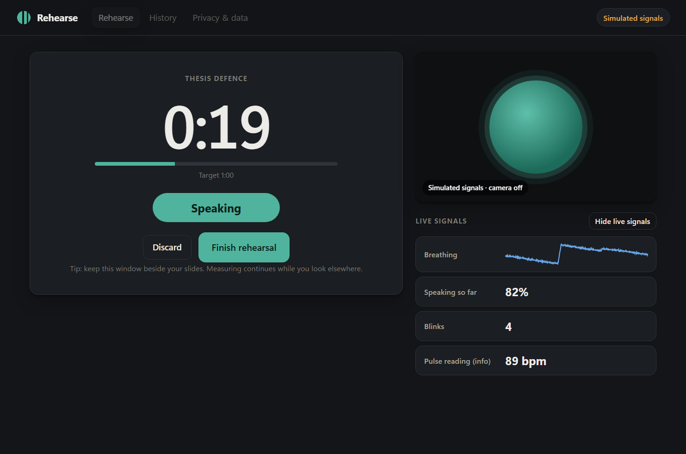
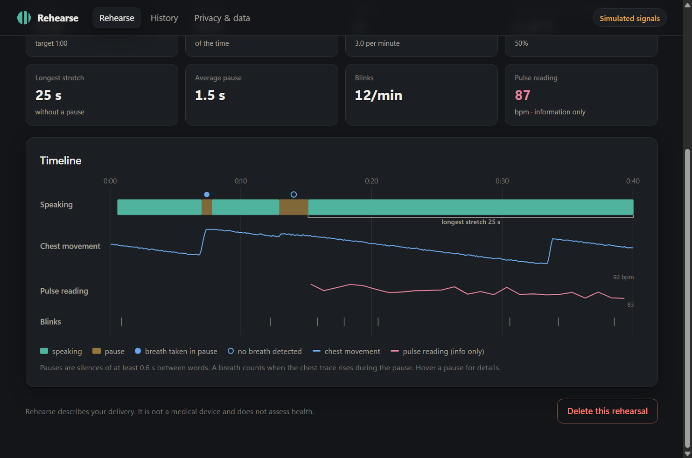
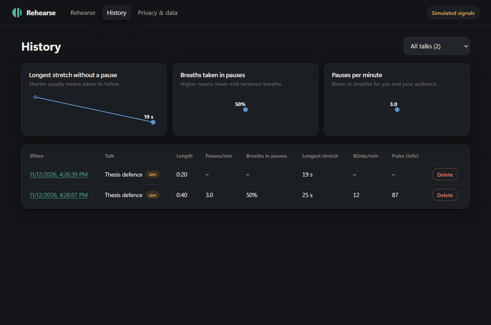
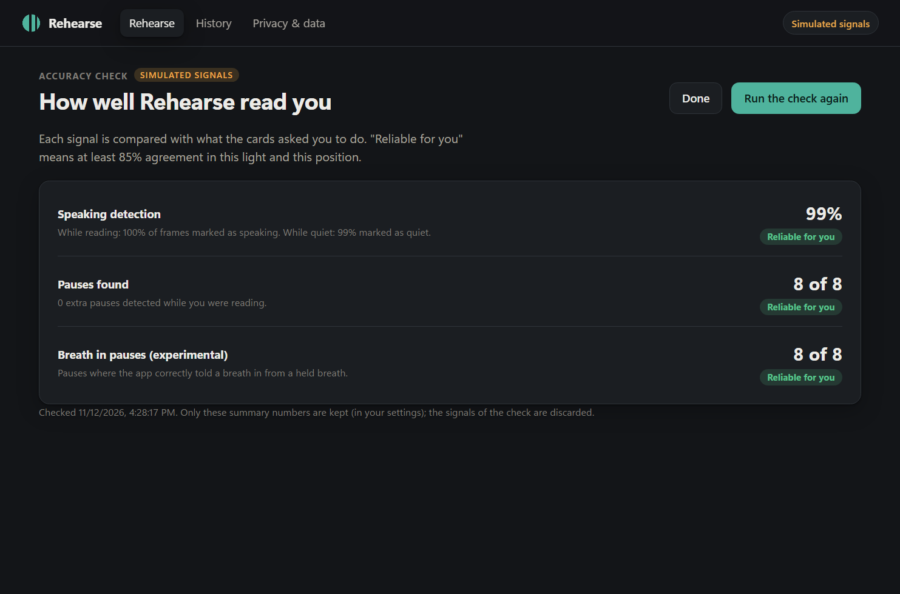

# Rehearse

**Practise a talk in front of your webcam.** Rehearse shows when you spoke, when you paused, and how long you went
without a pause. It uses no microphone, records nothing, and sends nothing anywhere.

Built with the [Presage SmartSpectra SDK](https://smartspectra.presagetech.com/docs/nodejs) for the
[DEV Presage SmartSpectra SDK Challenge](https://dev.to/challenges/presage-2026-11-04).

Most rehearsal tools listen to your voice. Rehearse watches your delivery instead: the rhythm of speech and silence,
and (experimentally) whether you breathe in your pauses rather than in the middle of a sentence. That makes it
usable in an open-plan office, on a train or late at night, and it means no audio of you ever exists.

| Rehearsal | Report |
|---|---|
|  |  |
| **History** | **Accuracy check** |
|  |  |

*Screenshots taken in simulated mode (no camera); the demo video shows the app with live signals.*

## What it does

1. **Calibrate (about 20 s).** The camera turns on with a live preview. A checklist shows when positioning, speaking
   detection, chest movement, face tracking and (optionally) the pulse reading are ready, with plain-language hints
   from the SDK ("Make your upper chest visible").
2. **Rehearse.** A large timer, an optional target length, and a live chip that says *Speaking* or *Pause 1.8 s*.
   After 45 s of speech without a pause, an optional quiet nudge suggests a pause. A side panel shows the live
   signals (chest movement, speaking share, blinks, pulse reading if enabled) and can be hidden.
3. **Review.** A report with notes in plain language ("Your longest stretch without a pause was 52 s, from 1:10. Try
   a short pause after each key point there."), key numbers, and a timeline: speaking blocks, pauses, the chest
   trace, the pulse reading and blinks.
4. **Compare.** History lists every run; for the same talk it draws trends (longest stretch, pauses per minute,
   breaths in pauses) and each report compares itself with the previous run of that talk.
5. **Check how well it reads you.** A guided 85-second check (read aloud, pause and breathe in, pause without
   breathing in) compares the signals with what you were asked to do and rates each one for *you*, in *your* light
   and position: "Reliable for you", "Use with care" or "Not reliable in these conditions".
6. **Delete.** One button removes every rehearsal, the check results and your consent from the computer.

## SmartSpectra signals used

| Signal | How Rehearse uses it |
|---|---|
| `face.landmarks` | Reduced on arrival to the inner-lip opening (and head angle); lip movement per second is the main speaking signal. Landmarks are never stored. |
| `face.talking` | Combined with lip movement (either one = speaking) |
| `breathing.upperTrace` (chest) | Live breathing sparkline; *experimental*: whether the trace rises during each pause (a breath in) |
| `face.blinking` | Blinks per minute, shown without interpretation |
| `cardio.pulseRate` (opt-in, off by default) | Pulse reading in the first vs the last 30 s, labelled *information only* |
| Validation status | Positioning hints during calibration; face-tracking warnings |

Speaking and silence drive everything else: pauses (silences of at least 0.6 s between words), the longest stretch
without a pause, pauses per minute and the live chip.

## How accurate is it? (measured, not claimed)

We ran the scripted check live on the developer's laptop webcam (Windows 11, integrated camera, indoor light) and
scored the signals with the same code the app uses (`node scripts/analyze_check.mjs <saved check>`). One person, one
camera: treat these as a sanity check, not a benchmark. That is why the app ships the check for each user.

| What | Result (live, 2026-11-12) |
|---|---|
| Scripted pauses found (silences of 3-4 s while reading) | **8 of 8** |
| Extra pauses detected while reading | 2 |
| Reading frames marked as speaking | 77% |
| Quiet frames marked as quiet | 87% |
| The SDK's `face.talking` alone, same run | 11% of reading frames marked as speaking |
| Breath in vs no breath in a pause | 2 of 8 right in that run; clearly separable in an earlier run with a stronger chest signal → **experimental** |

What we learned on the way, and what the app does about it:

- `face.talking` alone caught only 10-12% of read-aloud frames in three live runs, so Rehearse reads lip movement
  from the SDK's face landmarks and combines both. The lip threshold was set on the first half of the check's cards
  and confirmed on the second half (pauses found 4/4 in each half).
- The SDK stops sending face landmarks while the upper chest is out of view, and stops measuring if the camera
  frame rate stays under 25 fps. Calibration waits for steady positioning and live face tracking, the check warns
  when face tracking pauses, and if the SDK stops in the middle of a rehearsal, the report keeps what was measured
  and says so.
- Head direction (looking down at notes) and smiles were evaluated too. Head direction agreed only 50-89% of the
  time; smiles were reliable but the extra expression model lowered the frame rate towards the SDK's minimum. Neither
  is used in rehearsals.

## Requirements

- Windows 10/11 x64, macOS on Apple Silicon, or Linux x64/arm64 with glibc 2.35+ (the platforms the SDK supports).
  Developed and tested on Windows 11.
- Node.js 22.12 or newer.
- A webcam that delivers at least 25 frames per second (good light helps), and a SmartSpectra API key (free trial at
  <https://physiology.presagetech.com>) for live mode. Simulated mode needs neither.
- About 800 MB of disk for `node_modules`: npm downloads the SDK's native runtime for every platform (a few hundred
  MB, as the SDK documents) plus Electron.

## Setup

```bash
git clone https://github.com/emamira02/rehearse.git
cd rehearse
npm ci
```

Store your API key in an environment variable. Rehearse never asks for it in the UI and never writes it to disk.

```powershell
# Windows (PowerShell), once; then open a new terminal
[Environment]::SetEnvironmentVariable('SMARTSPECTRA_API_KEY', '<your key>', 'User')
```

```bash
# macOS / Linux, for the current shell
export SMARTSPECTRA_API_KEY='<your key>'
```

## Run

```bash
npm start          # live: camera + SmartSpectra SDK
npm run simulate   # simulated signals: camera off, SDK not loaded, no API key or credits needed
```

Without a key, `npm start` opens with a notice and a button to restart in simulated mode. The header always shows
which mode is running (*Live · SmartSpectra* or *Simulated signals*), and simulated rehearsals are labelled as such
in reports and history. Sit so that your face and upper chest are in view, with light in front of you.

## Tests

```bash
npm test                                      # unit tests: analysis, speech, simulator, notes, store, preload
npx electron scripts/e2e-sim.cjs 40           # end-to-end run of the real app in simulated mode, with screenshots
npx electron scripts/e2e-check.cjs --simulate # the accuracy check end to end, simulated
```

The end-to-end scripts use a throw-away data folder, click through the whole app, check what is written to disk,
delete everything and confirm nothing is left. Screenshots go to `results/`. With a key in `SMARTSPECTRA_API_KEY`,
`npx electron scripts/e2e-check.cjs` runs the check live (the person in front of the camera follows the cards) and
saves derived signals only (no images, no landmarks) for `scripts/analyze_check.mjs`.

## Consent and Data Handling

**Consent.** On first launch Rehearse shows a consent screen that explains what the camera is used for and what is
computed, stored and sent. Nothing can start until the person in front of the camera ticks *"I am the person in front
of the camera and I agree…"*. The camera turns on only when you press *Start calibration* or *Run the check*, stays
visible for the whole session (live preview, a *Camera on* label and the camera light) and turns off when you
finish, cancel, discard or close the window. Rehearse never requests the microphone: the app grants video-only
requests from its own page and denies everything else. It is meant for practising on yourself and must not be used
to measure anyone else.

**What is processed.** Camera frames are passed in memory to the SmartSpectra SDK on this computer, which computes
the chest breathing trace, talking and blinking (yes/no), face landmarks and, only if you switch on *Pulse reading*,
pulse rate. Rehearse requests only these metrics (no breathing rate, expressions, heart-rate variability or pressure
trace). Face landmarks are reduced on arrival to three numbers per frame (lip opening, head pitch and yaw) and the
points are discarded. Frames are never stored.

**Storage.** Each rehearsal is saved as a JSON file in your user-data folder (`%APPDATA%\Rehearse\rehearse-data` on
Windows, the equivalent Electron `userData` folder elsewhere): title, date, summary numbers, the speaking/pause
timeline, the chest trace reduced to 10 samples per second, blink times, pulse readings if enabled, and the app and
SDK versions. A settings file keeps the consent record, your preferences and the summary scores of your last
accuracy check. No images, video, audio, face landmarks or API key are stored. The Privacy & data page shows the
folder and opens it.

**Sharing.** Rehearse has no backend, no accounts and no analytics, and sends your data nowhere. The app window is
blocked from the network twice: a Content-Security-Policy with `connect-src 'none'` and a main-process filter that
cancels every http(s)/ws request from the page (the Privacy & data page shows how many were blocked: normally 0). In
live mode the SmartSpectra SDK, a native library in the app's main process, contacts Presage to validate the API key
and subscription.

**SDK telemetry.** The SDK sends telemetry by default (session summaries and diagnostic reports; per Presage's
[telemetry page](https://smartspectra.presagetech.com/docs/telemetry-and-privacy), no frames or measured values).
Rehearse switches it off (`enableTelemetry: false`).

**AI services.** Rehearse uses no AI service: the notes in the report come from fixed rules in `src/notes.js`.
Presage documents automatic "vitals insights": when breathing and cardio metrics are requested, the SDK sends periodic
snapshots of pulse rate, heart-rate variability and breathing rate (never images or video) to Presage's insight
service, which uses an LLM. We measured it: with the SDK's full breathing set, one insight packet arrived within
about 50 seconds; with Rehearse's request (chest trace only, no breathing rate), no insight packet arrived in three
live runs (about 8 minutes). Switching on the pulse reading adds cardio data, so expect such snapshots then; the
toggle says so and it is off by default. Rehearse never requests insights; any insight packet the SDK delivers is
counted on the Privacy & data page and discarded unread.

**Retention.** Rehearsals are kept until you delete them. Rehearse does not sync or back them up.

**Deletion.** Delete one rehearsal from its report or from History. *Delete all my data* on the Privacy & data page
removes every rehearsal, the consent record, the settings and the check results, clears the app's browser storage and
cache, and shows the consent screen again. The SDK manages its own working folder (`%APPDATA%\Rehearse\SmartSpectraSDK`
on Windows); Rehearse writes nothing there.

**API key.** The main process reads `SMARTSPECTRA_API_KEY` once, removes it from its environment so no child process
inherits it, and hands it only to the SDK's configuration message through the preload script. It never reaches the
page's JavaScript, the logs or the disk (`test/preload.test.js` checks this).

**Not medical.** Rehearse gives feedback on how you present. It does not diagnose, treat or assess any health
condition, makes no medical decisions, and its readings can be wrong. The pulse reading is shown as information only
and is never interpreted.

## How it works

```text
renderer (sandboxed page, no network)          preload (isolated)            main process
┌──────────────────────────────────────┐       ┌─────────────────┐       ┌──────────────────────────────┐
│ screens: consent, calibrate, rehearse│       │ SmartSpectra     │ port  │ bindSmartSpectraIpc(window)  │
│ report, history, check, privacy      │◄─────►│ bridge (+ API key│◄─────►│ native SDK (on-device)       │
│ LiveSource / SimSource (same events) │       │ on `configure`)  │       │ local JSON store             │
│ speech, pauses, breaths, runs        │       │ window.rehearse  │  IPC  │ network filter, permissions  │
└──────────────────────────────────────┘       └─────────────────┘       └──────────────────────────────┘
```

- `electron/main.cjs`: one locked-down window (context isolation, sandbox, no navigation or pop-ups), camera-only
  permission, network filter, API key handling, IPC for the store. The SDK binding is loaded only in live mode.
- `electron/preload.cjs`: the SDK's renderer bridge (same contract as `@smartspectra/node-sdk/preload`, checked by a
  test against the installed SDK) plus a small `window.rehearse` API.
- `electron/store.cjs`: atomic JSON writes; ids generated by the main process and validated on every access;
  only whitelisted fields reach the disk.
- `src/speech.js`: lip activity (change of the inner-lip opening per second over 0.6 s, centred in reports, trailing
  live) with a fixed threshold, combined with `face.talking`.
- `src/analysis.js`: pure functions. Speaking samples become segments (flips under 0.3 s are smoothed away);
  silences of at least 0.6 s between words are pauses; a pause has a breath when the chest trace rises by at least
  35% of the run's typical breath range after its minimum inside the pause.
- `src/check.js`: the accuracy check's cards and their scoring, shared by the app and the offline analysis.
- `src/sim.js`: a deterministic simulated speaker (speech breathing, word gaps, lip movement, long runs, blinks, a
  settling pulse reading) with the start-up delays measured on the real SDK, so the whole app can be developed and
  tested without a camera or credits.
- `src/renderer/`: the UI, written with plain DOM APIs (no innerHTML), bundled by esbuild.

## Limitations

- Tested by one person on one laptop camera. Run the in-app check to see how well it reads you.
- Speaking is read from lip movement: a hand or microphone in front of the mouth, chewing, or a very small face in
  the picture make it less reliable. Pause detection was validated on 3-4 s pauses; pauses shorter than about a
  second can be missed (the mouth closing at the end of a phrase also moves the lips). The lip threshold depends on how finely the SDK resolves the lips, which
  depends on camera resolution and distance.
- Breath detection in pauses needs your upper chest in view and still; it is experimental.
- The SDK needs your upper chest in view to keep tracking the face, and at least 25 frames per second; other heavy
  programs can push the frame rate below that.
- Signals need 10 to 30 seconds to settle, which is what the calibration step is for. The pulse reading takes about
  25 seconds and is compared start to end only for rehearsals of at least a minute.
- Live mode needs an internet connection for the SDK's key validation and uses SmartSpectra free-trial credits.

## License

Rehearse's own code is released under the MIT License (see `LICENSE`). The SmartSpectra SDK is distributed by
Presage Technologies under its own license and is installed from npm, not included in this repository.
